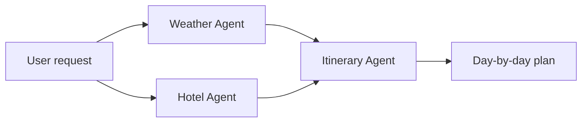

<div align="center">

# 🤖 Building AI Agents: LLMs, RAG & Knowledge Graphs

**A team training repo: hands-on notebooks and apps that take you from text embeddings and transformers to RAG, knowledge graphs, and multi-agent systems.**


[Overview](#overview) · [Learning Path](#suggested-learning-path) · [Chapters](#chapters) · [Quick Start](#quick-start) · [Featured Project](#featured-project-ai-travel-planner) · [Repo Structure](#repository-structure) · [Credits](#credits--attribution)

</div>

---

## Overview

This repository is used to **train our team on building AI agents**. It is a progressive,
hands-on path: each `chr*` folder holds the code for one stage, from how text is represented
and how transformers and LLMs work, to grounding an agent with RAG and knowledge graphs, and
finally combining everything into a multi-agent application.

**What you'll practise**

- 🧠 How LLMs work, their limits, and how to connect them to external data with RAG
- 🕸️ Building and querying knowledge graphs for structured, factual grounding
- 🛠️ Agents that plan, reason, and use tools (web scraping, search, APIs)
- 🎯 Techniques to reduce hallucinations and improve retrieval quality
- 🤝 Orchestrating multiple agents on multi-step problems
- 🚀 Packaging an agent as a Streamlit application

## Who This Is For

Engineers comfortable with Python who want a practical understanding of how LLM-based agents
are built, and what makes them reliable. No prior ML experience is required, but basic
familiarity with Jupyter and `pip` helps.

## Suggested Learning Path

| Session | Chapters | Goal |
|:-------:|----------|------|
| 1 | 1–2 | Understand text representation, attention, and the transformer |
| 2 | 3 | See what LLMs can and cannot do: bias, toxicity, prompt engineering |
| 3 | 4–5 | Build a tool-using agent, then ground it with basic RAG |
| 4 | 6–7 | Improve retrieval quality and add a knowledge graph |
| 5 | 8 | (Optional) Reinforcement learning intuition via the Super Mario agent |
| 6 | 9–10 | Combine agents into the Streamlit travel planner |

Suggested format: run the notebook before the session, then use the session to discuss
results, break things, and answer questions.

## Chapters

| # | Topic | What's inside | Notebook |
|:-:|-------|---------------|----------|
| 1 | Analyzing Text Data with Deep Learning | Text representation, embeddings, RNN/LSTM/GRU/CNN, review classification | [](https://colab.research.google.com/github/VenkateshDoijode/building-ai-agents/blob/main/chr1/Chapter%20I.ipynb) |
| 2 | The Transformer | Attention and self-attention, visualising internals, fine-tuning, knowledge distillation | [](https://colab.research.google.com/github/VenkateshDoijode/building-ai-agents/blob/main/chr2/Chapter_II.ipynb) |
| 3 | LLMs as a Powerful AI Engine | Bias and toxicity detection, multimodal models, prompt engineering | [](https://colab.research.google.com/github/VenkateshDoijode/building-ai-agents/blob/main/chr3/chapter%20III.ipynb) |
| 4 | Web Scraping Agent with an LLM | LangChain agent, tools, model speed comparison | [](https://colab.research.google.com/github/VenkateshDoijode/building-ai-agents/blob/main/chr4/Chapter%20IV.ipynb) |
| 5 | Extending Your Agent with RAG | Naive RAG, chunking strategies, retrieval to curb hallucinations | [](https://colab.research.google.com/github/VenkateshDoijode/building-ai-agents/blob/main/chr5/Chapter%20V.ipynb) |
| 6 | Advanced RAG Techniques | Elasticsearch retrieval, reranking, context enrichment | [](https://colab.research.google.com/github/VenkateshDoijode/building-ai-agents/blob/main/chr6/Advanced_RAG_concepts.ipynb) |
| 7 | Knowledge Graphs for Agents | Building graphs from unstructured data, querying, prompting | [](https://colab.research.google.com/github/VenkateshDoijode/building-ai-agents/blob/main/chr7/Creating_Knowledge_Graphs_From_Unstructured_Data.ipynb) |
| 8 | Reinforcement Learning and Agents | Bandits and RL basics, A3C agent playing Super Mario Bros | [](https://colab.research.google.com/github/VenkateshDoijode/building-ai-agents/blob/main/chr8/Chapter%20VIII.ipynb) |
| 9 | Single- and Multi-Agent Systems | Multi-agent travel planning system | [](https://colab.research.google.com/github/VenkateshDoijode/building-ai-agents/blob/main/chr9/Multi_Model%E2%80%93Travel_Planning_System_v_0_5.ipynb) |
| 10 | Building an AI Agent Application | Streamlit travel planner app | [`chr10/`](chr10) |

> 💡 Chapters 1–8 are notebooks; run them on Colab for a free GPU, or locally with Jupyter.

## Quick Start

```bash
# 1. Clone
git clone https://github.com/VenkateshDoijode/building-ai-agents.git
cd building-ai-agents

# 2. Create an environment
python3 -m venv venv
source venv/bin/activate          # Windows: venv\Scripts\activate

# 3. Install dependencies for the chapter you want, e.g. chapters 9-10
pip install -r chr10/requirements.txt

# 4. Launch Jupyter
jupyter lab
```

**Requirements**

| Tool | Notes |
|------|-------|
| Python 3.10+ | Windows, macOS, or Linux |
| PyTorch / Transformers | Used across most notebooks |
| Streamlit | Chapter 10 app |
| Docker | Optional, for services such as Elasticsearch (Chapter 6) |
| OpenAI API key | Needed for the itinerary generation in the Chapter 10 app |

## Featured Project: AI Travel Planner

Chapters 9 and 10 build a **multi-agent travel planner**, where each agent owns one job:

| Agent | Responsibility | Technique |
|-------|----------------|-----------|
| 🌦️ Weather Analysis Agent | Suggests the best months to visit | Random Forest regression |
| 🏨 Hotel Recommender Agent | Matches hotels to your preferences | Sentence embeddings (`all-MiniLM-L6-v2`) |
| 🗺️ Itinerary Agent | Writes a day-by-day plan | OpenAI GPT-4 |



**Run the app**

```bash
cd chr10
pip install -r requirements.txt

mkdir -p .streamlit
cat > .streamlit/secrets.toml <<'EOF'
[general]
openai_api_key = "YOUR_OPENAI_API_KEY"
EOF

streamlit run "Multi_Model–Travel_Planning_System_streamlit_v_0_2.py"
```

Then open <http://localhost:8501>. See [`chr10/README.md`](chr10/README.md) for known warnings and fixes.

## Repository Structure

```
building-ai-agents/
├── chr1/    # Text representation and deep learning for text
├── chr2/    # Transformers
├── chr3/    # LLMs, multimodal models, prompt engineering
├── chr4/    # Web scraping agent
├── chr5/    # RAG basics
├── chr6/    # Advanced RAG
├── chr7/    # Knowledge graphs
├── chr8/    # Reinforcement learning (Super Mario A3C)
├── chr9/    # Multi-agent travel planner (notebook + script)
├── chr10/   # Streamlit travel planner app
├── LICENSE.txt
└── README.md
```
## Super Mario RL – Live Demo


## Reference

The chapter's and topics from the book
**[*Building AI Agents with LLMs, RAG, and Knowledge Graphs*](https://amzn.in/d/0b1F1Fd9)**

**Maintained by** [Venkateshwara Doijode](https://github.com/VenkateshDoijode), Lead SDET.

## License

Released under the [MIT License](LICENSE.txt).
